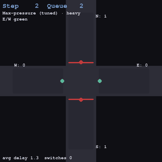
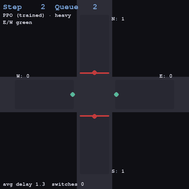
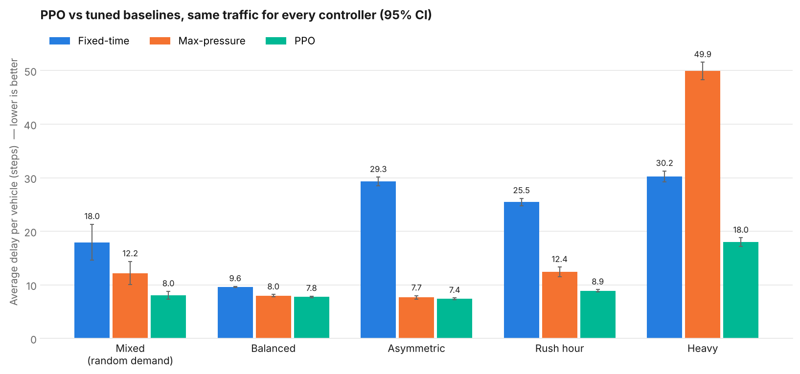
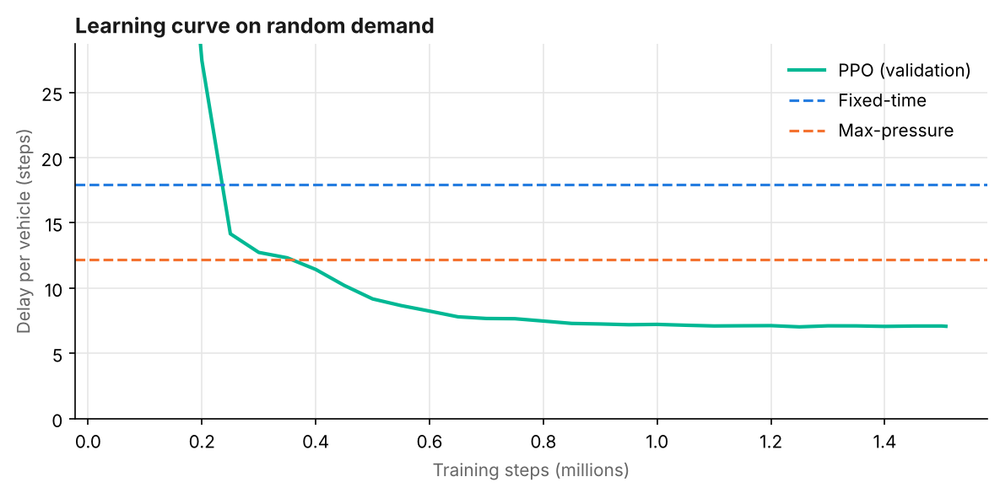

# 🚦 Traffic Signal Control with Reinforcement Learning

A custom **Gymnasium environment** simulating a 4-way intersection with realistic signal constraints (yellow clearance, minimum green, finite queues), and a **PPO agent** that learns to cut vehicle delay. It is compared against **tuned** engineering baselines, not a strawman.

---

## Demo

Same traffic (heavy scenario, seed 0) for both controllers:

| Max-pressure (tuned baseline) | PPO Agent (trained) |
|:--------------------:|:-------------------:|
|  |  |

> Under heavy load, max-pressure keeps chasing the longest queue and loses green time to yellows. PPO learns longer, demand-proportional greens: it switches about half as often and lets no cars spill back.

---

## Results

PPO trained for 1.5M steps (≈15 min on 2 CPU cores). Evaluated on 50 held-out episodes per scenario; **every controller sees identical arrivals** (common seeds). Metric = average delay per vehicle, in steps, ± 95% CI.



| Scenario | Fixed-time | Max-pressure | **PPO** | PPO vs best baseline |
|---|---|---|---|---|
| Mixed (random demand) | 17.96 ± 3.36 | 12.21 ± 2.17 | **8.05 ± 0.73** | **−34%** |
| Balanced | 9.61 ± 0.12 | 8.01 ± 0.19 | **7.77 ± 0.13** | −3% |
| Asymmetric | 29.31 ± 0.81 | 7.67 ± 0.32 | **7.39 ± 0.17** | −4% |
| Rush hour (shifting demand) | 25.45 ± 0.71 | 12.43 ± 0.88 | **8.92 ± 0.20** | **−28%** |
| Heavy (near capacity) | 30.23 ± 1.02 | 49.93 ± 1.63 | **17.98 ± 0.80** | **−40%** |

All PPO improvements are statistically significant (paired test). Full per-metric table: [`results/results.md`](results/results.md).

**Stress test.** Even when each baseline is re-tuned *separately for every scenario* (an oracle advantage, since a real controller doesn't know tomorrow's demand), the single PPO policy still wins: e.g. Heavy 17.98 vs 20.45 (best oracle max-pressure), Rush hour 8.92 vs 9.90.

**Where the gains come from.** On steady, easy traffic, PPO only edges out max-pressure (≈3%); a good actuated controller is already near-optimal there. The big wins come when demand is heavy or shifting. Fixed plans can't adapt, and greedy queue-chasing switches too often near capacity. PPO adapts how long each green lasts to the current load.



---

## Environment

Built from scratch on the [Gymnasium](https://gymnasium.farama.org/) API (`env/traffic_env.py`).

- **Action** `Discrete(2)`: which phase should be green (0 = N/S, 1 = E/W). Changing phase triggers a **3-step yellow** during which nobody moves; each green must last **≥ 5 steps**.
- **Observation** `(16,)`, all in [0, 1]: queue per lane, smoothed arrival rate per lane (loop-detector estimate), time since each lane last had green, current phase, yellow flag, time in current phase.
- **Reward**: −(vehicles queued + 5 × vehicles spilled back), scaled. Summed over an episode this is total delay, so maximising reward = minimising delay.
- **Demand**: Bernoulli arrivals per lane. During training every episode samples a new scenario (load, N/S-vs-E/W split, how fast the split drifts, minor-lane ratio). Named evaluation scenarios live in `SCENARIOS`.
- **Episode**: 720 steps, ended by *truncation* (time limit), so PPO bootstraps correctly.
- Everything is configurable via `TrafficEnv(**overrides)` / `EnvConfig`.

### Baselines (`baselines.py`)

- **Fixed-time**: pre-timed plan; green splits grid-searched on separate tuning seeds.
- **Max-pressure**: queue-actuated; switches when the other phase's queue exceeds the current one by a threshold, plus a max-green cap. Threshold and cap are grid-searched.

Tuning, validation (checkpoint selection) and test seeds are disjoint.

---

## What changed from v1 (and why)

The original setup produced an impressive-looking number for the wrong reason: switching lights cost nothing, so the best policy was to flip the light every step. Measured on the v1 env:

| v1 controller | Avg queue |
|---|---|
| Fixed timer, 10-step period (the README baseline) | 3.72 |
| v1 PPO agent | 0.605 |
| Fixed timer flipping **every step** | 0.604 |
| One-line "greenest queue first" rule | 0.596 |

So the "83% reduction" came from comparing against a badly tuned timer, not from learning. Fixes:

- **Switching costs** (yellow + min green) so the control problem is non-trivial and realistic.
- **`terminated` → `truncated`** at the time limit (v1 told PPO the episode end was a terminal state, corrupting value targets).
- **Stationary, normalized observations**: v1 fed cumulative wait totals that grew without limit and exceeded the declared bounds (540 > 500).
- **Removed dominated actions**: "N only" / "E only" were never better than N+S / E+W, and the agent never used them. Removed dead code (`GREEN_DUR`, `phase_timer`).
- **Spill-back is tracked and penalised**: v1 silently dropped cars at the queue cap, which *reduced* the penalty.
- **Fair evaluation**: tuned baselines, common random numbers, held-out seeds, confidence intervals, multiple scenarios.
- **Training**: reward normalisation, LR schedule, larger batches, seeding, CLI flags, and best-checkpoint selection on a *fixed* validation set (SB3's `EvalCallback` re-samples episodes each time, so "best" was partly luck).
- Headless rendering, unit tests, and `env.render()` support.

---

## Project Structure

```
traffic-rl-ppo/
├── env/
│   ├── traffic_env.py    # Gymnasium environment + demand scenarios
│   └── rendering.py      # off-screen pygame renderer
├── baselines.py          # fixed-time & max-pressure controllers + tuner
├── train.py              # PPO training (Stable-Baselines3)
├── evaluate.py           # paired comparison, CIs, plots
├── visualize.py          # GIF recorder (headless)
├── tests/test_env.py     # env invariants (pytest)
├── models/               # best_model.zip, ppo_traffic.zip, val_curve.csv
└── results/              # baseline params, raw + summary results
```

---

## Getting Started

```bash
git clone https://github.com/Pranjal-agl/traffic-rl-ppo.git
cd traffic-rl-ppo
python3 -m venv venv && source venv/bin/activate
pip install -r requirements.txt
pytest -q                                  # sanity-check the environment
```

**Train** (≈15 min on CPU; best checkpoint → `models/best_model.zip`)
```bash
python train.py                            # --timesteps, --n-envs, --seed, --out
```

**Evaluate** against the baselines (writes `metrics.png`, `results/`)
```bash
python evaluate.py                         # --episodes 100, --model …, --retune
```

**Record a GIF**
```bash
python visualize.py                                   # PPO → agent_demo.gif
python visualize.py --policy max-pressure --out baseline_demo.gif
python visualize.py --policy fixed-time --scenario rush_hour --seed 3
```

---

## Tech Stack

Python 3.10+ · [Gymnasium](https://gymnasium.farama.org/) · [Stable-Baselines3](https://stable-baselines3.readthedocs.io/) · PyTorch · Pygame · Matplotlib · pytest

---

## Key Concepts

- **PPO (Proximal Policy Optimization)**: on-policy actor-critic that clips policy updates for stable training.
- **Domain randomisation**: training on freshly sampled demand each episode so one policy generalises across traffic conditions.
- **Max-pressure control**: a standard adaptive signal-control heuristic; a strong, honest baseline.
- **Common random numbers**: evaluating every controller on identical arrivals, so differences reflect the controller, not luck.

---

## Related Projects

This project is thematically linked to [quantum-traffic-routing](https://github.com/Pranjal-agl/quantum-traffic-routing), which explores the same traffic optimization problem using QAOA on a quantum computing framework.
